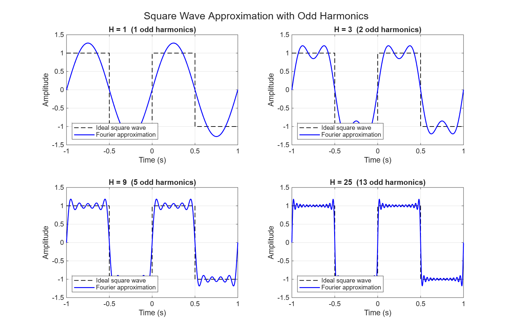
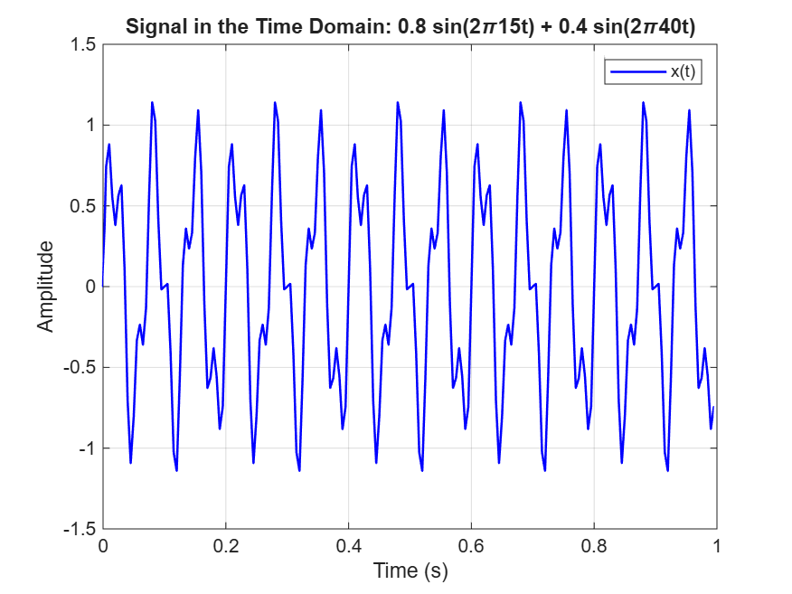
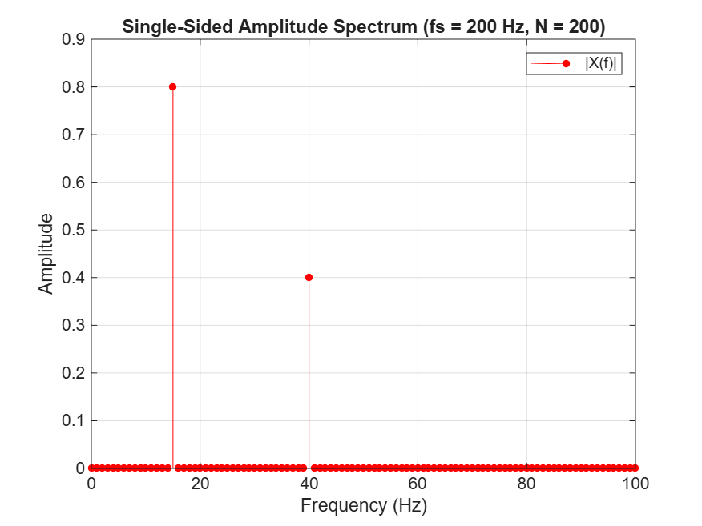
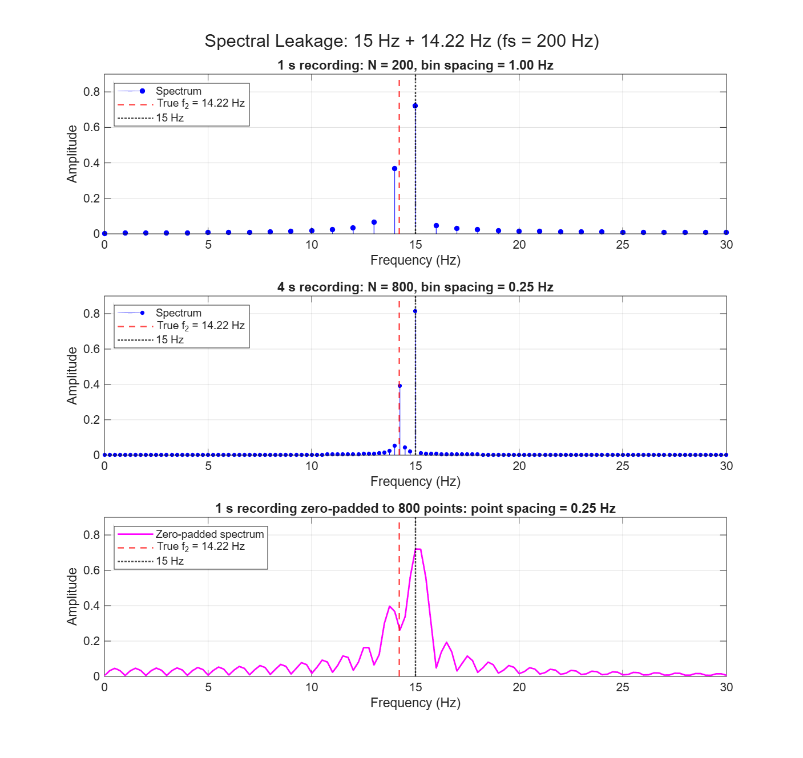
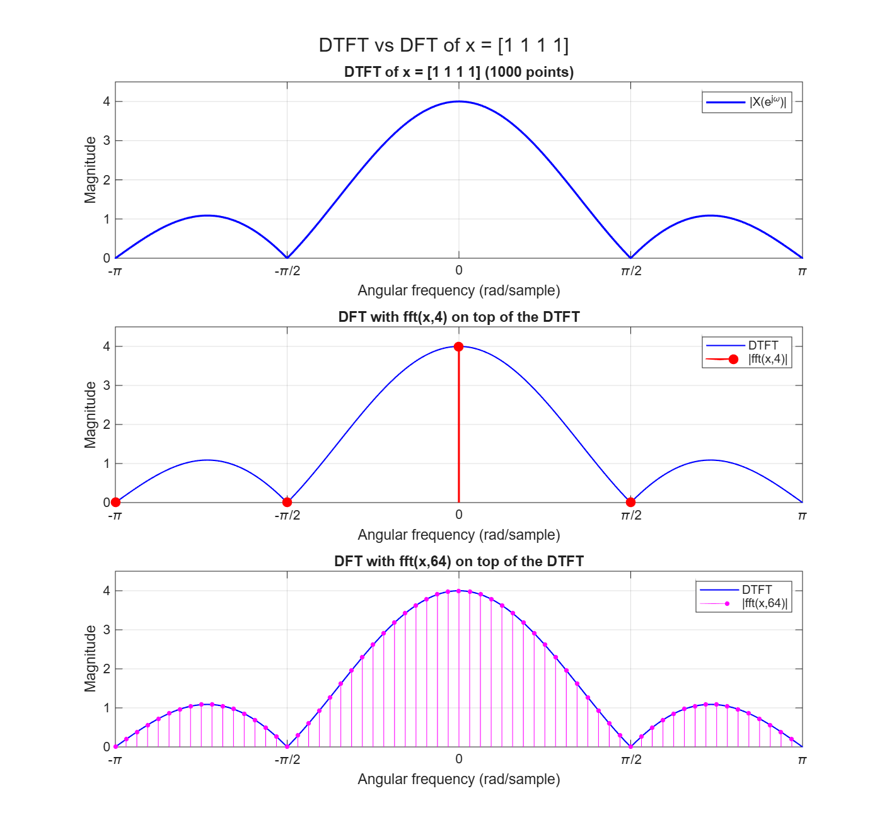

# Lecture 5 – Fourier Series, DTFT and DFT

**Author:** MD Shahriar Fardin Protya
**Course:** Digital Signal Processing, Savonia UAS

MATLAB experiments that build a square wave from harmonics, find frequencies with the FFT, investigate spectral leakage, and compare the DTFT with the DFT.

**Last digit used in Exercise 3:** d = 6

## Repository structure

```
lecture-5-fourier-assignment/
├── README.md
├── exercise-1/   exercise1.m, square-wave-comparison.png
├── exercise-2/   exercise2.m, time-domain-signal.png, two-frequency-spectrum.png
├── exercise-3/   exercise3.m, leakage-comparison.png
└── exercise-4/   exercise4.m, dtft-dft-comparison.png
```

**How to run:** open the exercise folder in MATLAB, open the `.m` file and press **Run**. Each script saves its figures in its own folder and prints its key values in the Command Window.

---

## Exercise 1 – Build a Square Wave from Harmonics



**Prediction (before running):**
With H = 1, the result is just one sine wave. As more odd harmonics are added, the waveform should get flatter at the top and bottom, and the jumps between +1 and −1 should get steeper, so it looks more and more like a square wave. Each extra harmonic is smaller (amplitude 4/(πk)), so the changes should get smaller as H grows.

**What changes as H increases:**
- **H = 1:** a pure 1 Hz sine wave. Its peak is 4/π ≈ 1.27, which is higher than the square wave's level of 1.
- **H = 3 and H = 9:** the top and bottom become flatter but have visible ripples. The edges get steeper.
- **H = 25:** very close to the ideal square wave. It is flat with small, fast ripples, and the transitions are almost vertical.

The ripples get faster as H increases because the highest harmonic (H Hz) sets how fast the ripple oscillates. They also get smaller in the middle of the flat parts.

**Near the sharp transitions:**
Right next to every jump, the approximation **overshoots** above +1 (and undershoots below −1). This overshoot does not disappear as H increases:

| H | Maximum value |
|---|---------------|
| 1 | 1.273 |
| 3 | 1.200 |
| 9 | 1.182 |
| 25 | 1.179 |

The overshoot settles at about 1.18, about 9% of the jump size (the jump is 2). Adding more harmonics only makes the overshoot narrower and pushes it closer to the jump; its height doesn't go away. This is the **Gibbs phenomenon**. A sum of smooth sine waves can never make a perfectly vertical jump, so it always "rings" around the discontinuity.

---

## Exercise 2 – Find Two Frequencies with the FFT




**Prediction (before running):**
x(t) = 0.8 sin(2π·15t) + 0.4 sin(2π·40t). I expect two peaks:
- **15 Hz** with amplitude **0.8**
- **40 Hz** with amplitude **0.4**

**Bin spacing:**

```
N  = fs · T = 200 · 1 = 200 samples
Δf = fs / N = 200 / 200 = 1 Hz
```

The FFT gives one value every 1 Hz, from 0 Hz up to fs/2 = 100 Hz (101 points).

**Expected vs measured:**

| Component | Expected f | Measured f | Expected amplitude | Measured amplitude |
|-----------|-----------|------------|--------------------|--------------------|
| 1 | 15 Hz | 15 Hz | 0.8 | 0.800 |
| 2 | 40 Hz | 40 Hz | 0.4 | 0.400 |

The measured values match exactly, and all other bins are practically zero. This is because both frequencies are whole numbers of Hz. Each one fits a whole number of cycles in the 1-second recording (15 and 40 cycles), so each falls exactly on a frequency bin. In the time-domain plot, the signal looks like a 15 Hz wave with a faster, smaller 40 Hz ripple on top.

---

## Exercise 3 – Investigate Spectral Leakage



**My values:**

```
d  = 6
f2 = 13.2 + 0.17 · 6 = 13.2 + 1.02 = 14.22 Hz
```

**Prediction (before running):**
14.22 Hz is not a whole number, so in a 1-second recording the signal does not complete a whole number of cycles (14.22 cycles). It falls between the bins at 14 Hz and 15 Hz. I expect the f2 peak to **not** appear as a single clean line. Instead, it should spread into neighbouring bins (leakage), and its height should be lower than 0.4. Because 14.22 Hz is very close to 15 Hz, I also expect the two peaks to be hard to tell apart.

**1-second recording (N = 200, Δf = 1 Hz):**
- The largest values are at **14 Hz (0.367)** and **15 Hz (0.721)**.
- The f2 peak shows up in the 14 Hz bin, the nearest bin, but it is too low (0.367 instead of 0.4). Energy has leaked into the surrounding bins: there are non-zero values from about 11 to 18 Hz.
- The leaked energy also overlaps the 15 Hz bin, so even the 15 Hz component reads 0.721 instead of 0.8, although 15 Hz itself fits the grid perfectly. The two components are less than one bin apart, so they disturb each other.

**4-second recording (N = 800, Δf = 0.25 Hz):**

```
Δf = fs / N = 200 / 800 = 0.25 Hz
```

- The bins are now 4 times closer together. There is a bin at 14.25 Hz, only 0.03 Hz from f2.
- The peaks are at **14.25 Hz (0.391)** and **15 Hz (0.814)**, both close to the true amplitudes of 0.4 and 0.8.
- The two peaks are clearly separate, with low bins between them, and the leakage into other bins is much smaller (below about 0.05).

A longer recording gives finer frequency resolution (Δf = 1/T), so the peak is sharper, closer to the right frequency and closer to the right amplitude.

**Zero-padding, fft(x, 4·length(x)) on the 1-second recording:**
- The plot now has a point every 0.25 Hz, so it looks like a smooth curve instead of separate bins.
- It shows the shape that was "hidden" between the 1 Hz bins: wide peaks with side ripples (sidelobes).
- But the two components at 14.22 Hz and 15 Hz are still blurred together. Zero-padding did **not** separate them the way the 4-second recording did.

**Does zero-padding add information?** No. Zero-padding only adds zeros after the 200 real samples. It interpolates the same spectrum at more points, so the plot looks smoother, but the original recording is still 1 second long. The real frequency resolution is still about 1/T = 1 Hz. To actually resolve close frequencies, you need a **longer recording**, not more FFT points.

---

## Exercise 4 – Compare the DTFT and DFT



x = [1 1 1 1], n = 0…3. The DTFT is calculated at 1000 points between −π and π. The DFT is calculated with `fft(x,4)` and `fft(x,64)`. The DFT values are placed at ω = 2πk/N (using `fftshift`), so they line up with the DTFT.

**Task 4 – Compare the smooth DTFT curve with the DFT values:**
The DTFT is a continuous curve with a main peak of **4 at ω = 0** and smaller side lobes. Every DFT value lies **exactly on** the DTFT curve, because the DFT is just the DTFT sampled at N evenly spaced frequencies.
- `fft(x,4)` = [4, 0, 0, 0]. Its 4 samples fall at ω = 0, ±π/2 and π, which are exactly the peak and the zeros of the DTFT. Looking only at these 4 values, the spectrum looks like a single spike, and the side lobes are completely hidden.
- `fft(x,64)` samples the same curve at 64 points, so the stems trace out the full DTFT shape, including the side lobes.

**Task 5 – Why does fft(x,64) give more points? Does it add new samples?**
`fft(x,64)` zero-pads the sequence to 64 samples: [1 1 1 1 0 0 … 0]. A 64-point DFT gives 64 frequency values, with spacing 2π/64 instead of 2π/4. It does **not** add any new signal samples, because the 60 extra values are zeros. The DTFT stays exactly the same, and we just sample it more densely. So it gives a better view of the same spectrum, not more information about the signal.

**Task 6 – Where does the DTFT magnitude become zero?**
From the plot, the magnitude is zero at **ω = ±π/2 and ω = ±π**.
Check: |X(e^{jω})| = |sin(2ω) / sin(ω/2)|. This is zero when sin(2ω) = 0, i.e. ω = ±π/2, ±π (but not at ω = 0, where the value is 4).

---

## AI Usage

I used **Claude (Anthropic)** to help with this assignment. I gave it the assignment text, and it wrote the MATLAB scripts for all four exercises (based on the provided starting code) and a draft of the explanations in this README.

I ran every script myself in MATLAB Online and checked the results:
- The printed peak values (15 Hz → 0.800, 40 Hz → 0.400; the leakage values for 1 s and 4 s) match the tables above.
- I calculated f2 and the bin spacings (1 Hz and 0.25 Hz) by hand.
- I checked that `fft(x,4)` prints [4 0 0 0], and that the DTFT zeros are at ±π/2 and ±π in my plot.
- I read through the explanations and made sure I can explain each plot myself.
<!-- Add anything you changed yourself, e.g. colours, axis limits, wording. -->
